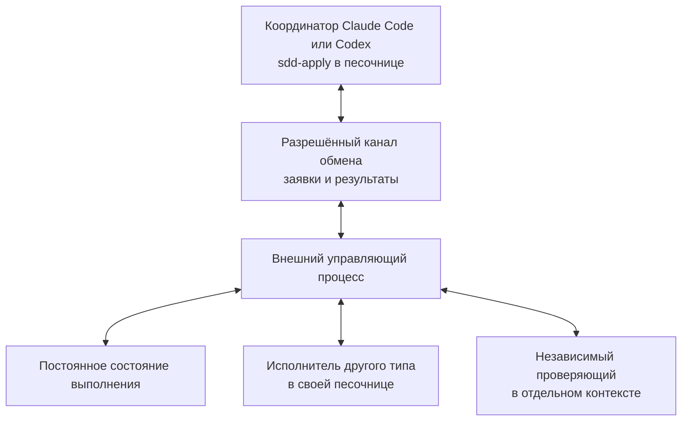

# Внешняя оркестрация Claude Code и Codex для sdd-apply

Orca от Stably и HumanLayer предоставляют инфраструктуру для запуска разных кодовых агентов. Для требуемого цикла `sdd-apply` первым кандидатом на ограниченную проверку предлагается Orca: у него явно описаны задания, попытки выполнения и сообщения между координатором и исполнителями. HumanLayer подходит как кандидат на общую среду задач и сессий. Работа обоих продуктов через существующие границы песочниц и их совместимость с протоколом SDD остаются непроверенными.

Отчёт сохранён 31 октября 2026 года по исследованию и обсуждению от 30 октября. Веб-источники при сохранении повторно не проверялись; ссылки ведут на изменяемую документацию. Инструменты не устанавливались, агентные циклы и восстановление после сбоя не запускались. Это основание для выбора проверочного сценария, а не утверждённый план изменения `sdd-apply`.

## 1. Потребность и границы

Пользователю требуется сохранить координатора `sdd-apply` в Claude Code или Codex и назначать исполнителей в другой агентной среде. Например, Claude Code координирует работу, Codex реализует задачу, затем отдельный агент проверяет результат. Обратное распределение должно оставаться возможным.

По условию пользователя, агенты работают в песочницах и не могут запускать друг друга напрямую или через MCP. Запуском должна управлять внешняя по отношению к агентам среда. В этом отчёте «другая агентная среда» означает Claude Code или Codex; она не обязательно находится на другой физической машине.

Общий результат для сравнения вариантов:

- Координатор назначает ограниченное задание исполнителю выбранного типа.
- Внешний процесс запускает и наблюдает исполнителя, не расширяя права координатора.
- Результат связан с заданием, конкретной попыткой и проверенной ревизией проекта.
- Координатор получает результат и продолжает цикл, включая независимую проверку.
- Состояние позволяет восстановиться после остановки сессии без повторного запуска уже выполняющейся работы.

Наличие двух провайдеров в интерфейсе продукта подтверждает возможность выбора агента. Оно само по себе не подтверждает автоматическую передачу задания между ними, сохранение песочниц или выполнение контрактов SDD.

## 2. Разделение ответственности по FPF

Использована установленная адаптация [fpf-problem-solving][fpf], основанная на upstream-коммите `c475118bc1c11d2921b14f74c876e69c24ced3ea`. Два паттерна задают основу сравнения:

| Паттерн | Вклад |
|---|---|
| [C.38 — сопоставимые способы получить один результат][fpf-c38] | Сравнивать полные конфигурации, включая интеграцию, передачу результатов и сопровождение |
| [A.15.8 — конфигурация выполнения и проверка восстановления][fpf-a158] | Указать исполнителей, внешнюю поддержку и состояние, необходимое после перерыва; проверить критическую зависимость |

Предлагаемая архитектура разделяет три ответственности:

| Часть | Ответственность |
|---|---|
| Агент-координатор с `sdd-apply` | Выбор следующей задачи, назначение ролей, содержательная оценка результатов и решение о продолжении |
| Внешний управляющий процесс | Запуск сессий, доставка заданий и ответов, наблюдение за процессами, остановка и восстановление связи |
| Постоянное состояние выполнения | Задания, попытки, идентичности сессий, результаты проверок и незавершённые действия |

Диаграмма показывает предлагаемое устройство, а не подтверждённую конфигурацию Orca или HumanLayer. Разрешённым каналом может служить каталог обмена, доступный агенту и внешнему процессу, либо структурированный ввод и вывод управляемой сессии. Такой мост ещё предстоит реализовать или подтвердить в выбранном продукте. Если никакого разрешённого канала через границу нет, автоматическая координация невозможна.

Внешний процесс должен принимать ограниченные заявки на запуск известных ролей и сред. Общая очередь произвольных команд с полномочиями хоста не сохраняет исходную границу изоляции. Worktree разделяет рабочие копии Git; требуемые ограничения файлового, сетевого и процессного доступа задаются и проверяются отдельно.

## 3. Что уже есть в sdd-apply

Текущие адаптеры Codex и Claude Code используют фактически доступные инструменты хоста. Они предусматривают свежий контекст, ожидание регистрации, идентичность реального запуска и последующую доставку пакета задания. Чистая CLI-сессия допускается после проверки среды, когда необходимые нативные возможности отсутствуют. [Адаптер Codex][sdd-codex], [адаптер Claude Code][sdd-claude].

Операция `resolve_agent` разрешает выбор роли, но не запускает агента. При регистрации сохраняются сведения о выбранной конфигурации и наблюдаемом запуске. Изменение источников конфигурации после прерывания требует согласования состояния. [Выбор субагентов][sdd-subagents].

Generic-адаптер требует подтвердить доступ к файлам, командам, постоянному состоянию, свежим контекстам, обмену сообщениями и доказательствам запуска. Он запрещает выдавать словесное описание возможностей за их реализацию и заменять независимое ревью самопроверкой. [Generic-адаптер][sdd-generic], [API выполнения][sdd-api].

Следствие для интеграции: потребуется адаптер внешней среды, сохраняющий эти контракты. Одного изменения промпта или выбора другого провайдера недостаточно. Источником истины для приёмки задач должен оставаться один согласованный механизм; завершение процесса во внешнем продукте не должно автоматически означать приёмку SDD-задачи.

## 4. Orca от Stably

Рассматривался именно [onorca.dev][orca-home], указанный пользователем. Продукты с таким же названием из других репозиториев не входят в выводы об Orca.

### Подтверждённые возможности

Orca документирует экспериментальный слой оркестрации с `Run`, заданиями, зависимостями, `Dispatch`, сообщениями и блокирующими вопросами. `Run` хранит пространство выполнения и почтовый ящик координатора; назначение исполнителей остаётся отдельным действием. Для запуска выбираются агент, worktree и, где поддержано, модель и effort. [Orca Orchestration][orca-orchestration].

Сообщения доставляются с подтверждением получения. Завершение исполнителя связано с идентификаторами задания и попытки. Предусмотрены чтение вывода, остановка, освобождение исполнителя и явный повторный запуск. Координатор и исполнители используют команды `orca orchestration`; исполнитель отправляет `worker_done`. [Протокол Orca][orca-orchestration].

CLI обращается к работающему runtime. Документация предлагает сначала проверить его доступность через `orca status --json`. Для фонового runtime описан `orca serve`; в CLI reference отмечены ограничения доступности этих серверных команд на Windows. [CLI reference][orca-cli].

### Соответствие ограничениям пользователя

Если песочница допускает обращение к Orca как к разрешённому посреднику, его протокол может обеспечить транспорт внешнего адаптера SDD. Это архитектурный вывод, требующий проверки реального запуска и полномочий.

Если из песочницы недоступен и CLI Orca, нужен внешний мост заявок и результатов. Готовый файловый транспорт для этого режима в просмотренной документации не подтверждён. Это пробел в доказательствах соответствия, а не утверждение, что такую интеграцию невозможно создать.

Orca остаётся первым кандидатом на пробу благодаря явному протоколу координации. Экспериментальный статус и доступ через границу песочницы являются условиями выбора, которые нельзя считать закрытыми чтением документации.

## 5. HumanLayer

Рассматривался текущий продукт HumanLayer с задачами, сессиями и daemon, а не только исторический SDK согласований с человеком. Репозиторий описывает общую систему desktop/web-интерфейсов и процессов на пользовательских машинах. [HumanLayer README][hl-readme].

### Внешний запуск и состояние

Daemon запускает Claude или Codex на своём хосте. API передаёт ему работу, а события сессий возвращаются в интерфейсы через API. Штатная схема требует исходящего доступа к API и синхронизации HumanLayer. [Архитектура daemon][hl-daemons].

Задача объединяет отдельные сессии, общие файлы и обсуждение. Файлы задачи доступны через `.humanlayer/tasks/<task-slug>/`. Их синхронизация связана с поддерживаемыми файловыми инструментами агента: файл не загружается только потому, что другой процесс положил его в каталог. Поэтому синхронизацию артефактов нельзя без проверки использовать как универсальный файловый транспорт заявок. [Задачи и синхронизация][hl-tasks].

В release notes версии 0.179.0 описана передача работы между Claude Code и Codex с продолжением в новой сессии на том же задании и worktree. Такая передача подтверждает перенос контекста, но ещё не доказывает цикл делегирования с возвращением результата прежнему координатору. [Release notes][hl-releases].

### Межагентное делегирование

Документированные RPI-субагенты Claude Code используют Claude-модели; Codex-субагенты используют GPT-модель родителя. Документация также указывает, что Codex-сессии работают через CodeLayer. Эти сведения не подтверждают штатное делегирование между двумя агентными средами и не гарантируют перенос настроек текущего Codex пользователя. [Модели субагентов][hl-subagents].

HumanLayer предоставляет необходимые части для внешнего адаптера: запуск, сессии, состояние и артефакты. Автоматическое принятие заявки от изолированного координатора, запуск исполнителя другого типа и возвращение результата в исходную сессию остаются предметом проверки.

### Песочницы и размещение

По описанию модели доступа daemon предоставляет агентам файловые и сетевые права пользователя, под которым работает. Для контейнеров и возобновляемых хостов отдельно описано сохранение идентичности и данных сессий. Это не обещание изоляции каждой сессии от остальных. [Модель доступа и восстановление][hl-daemons].

Команда `humanlayer automation run` создаёт daemon на время одного задания и запускает агента с обходом запросов разрешений. Обход запросов разрешений не равен доказанному отключению любой внешней песочницы, но этот режим нельзя автоматически считать эквивалентом нынешнему запуску пользователя. [Автоматизация HumanLayer][hl-automation].

Для Windows и Linux документирован удалённый daemon с управлением из браузера. Полное самостоятельное размещение системы отличается от размещения только daemon: README сообщает, что руководства по self-hosting ещё готовятся. [Удалённый запуск][hl-remote], [HumanLayer README][hl-readme].

HumanLayer стоит рассматривать при потребности в общей среде задач, документов, ревью и удалённых сессий. Для сохранения существующего цикла `sdd-apply` он пока подтверждён как инфраструктурный кандидат; готовность всего сценария не установлена.

## 6. Сопоставление вариантов

| Вариант | Подтверждённая основа | Что требуется для целевого результата |
|---|---|---|
| Orca | Протокол заданий, попыток и сообщений; разные агенты | Проверить границу песочницы и адаптировать контракты SDD |
| HumanLayer | Daemon, API, задачи, сессии, артефакты | Подтвердить делегирование между средами, возврат результата и сохранение изоляции |
| Orchestrator.inc | Внешний daemon, постоянное состояние, адаптеры и события | Проверить транспорт из песочницы и совместимость правил выполнения с SDD |
| Vibe Kanban | Рабочие пространства и сессии разных агентов | Документированный путь автоматизации через MCP не удовлетворяет исходному ограничению; нужен иной разрешённый путь |
| Собственный управляющий процесс | Программные интерфейсы агентных сред | Реализовать диспетчеризацию, состояние, восстановление и адаптер SDD |

Orchestrator.inc, ранее доступный по адресу Composio Agent Orchestrator, описывает локальный daemon, SQLite, события и адаптеры сессий. Его CLI является клиентом HTTP API. Эти свойства делают его дополнительным кандидатом, но не снимают вопрос доступа из песочницы. [Архитектура Orchestrator.inc][ao-architecture].

Vibe Kanban документирует `start_workspace` и управление сессиями через MCP с выбором Claude Code или Codex. При заданном запрете MCP-вызова такой способ не закрывает потребность пользователя. [Vibe Kanban MCP][vk-mcp].

Собственный процесс технически можно строить на программном запуске Claude Code со структурированным выводом и интерфейсе Codex App Server. Это готовые интерфейсы отдельных агентов; координацию, сохранение состояния и восстановление они не реализуют за интегратора. [Claude Code programmatic usage][claude-headless], [Codex App Server][codex-app-server].

## 7. Предлагаемая проверка перед выбором

Первый проверочный сценарий должен закрыть границу доступа и восстановление, которые могут изменить выбор продукта. Установка, выполнение и изменение SDD этим отчётом не проводились.

1. Зафиксировать версии продукта и агентных сред, фактические профили доступа, рабочие каталоги и разрешённый канал обмена.
2. Запустить координатора `sdd-apply` в свежем контексте. Передать ограниченную задачу исполнителю другой агентной среды через внешний процесс.
3. Подтвердить реальную идентичность исполнителя и свежесть его контекста. Связать пакет задания с попыткой и исходной ревизией.
4. Получить изменение и отчёт. Передать результат независимому проверяющему с соблюдением контракта SDD; завершение исполнителя не считать приёмкой.
5. Прервать координатора после регистрации исполнителя, затем восстановить его из постоянного состояния. Проверить отсутствие второй конкурирующей попытки и повторной приёмки старого результата.
6. Вернуть результат в восстановленную сессию, продолжить цикл и подтвердить, что права координатора и исполнителей не расширились.

Сохранить журнал запусков и переходов состояния, идентификаторы задания и попыток, ссылки на проверенную ревизию, результат независимой проверки и наблюдения о правах доступа. Успех этого сценария подтверждает только проверенную конфигурацию; обратное распределение Claude/Codex потребует отдельного подтверждения, если его поведение отличается.

Если Orca выполняет сценарий через разрешённый интерфейс, следующий шаг — проектирование адаптера SDD. Если единственный разрыв состоит в транспорте из песочницы, сравнить стоимость узкого моста с собственным управляющим процессом. Если HumanLayer лучше соответствует требуемой среде задач и ревью, провести тот же сценарий, сохранив одинаковые критерии.

## 8. Основания и ссылки

Локальные ссылки показывают текущие файлы репозитория; снимок основания указан в `local_commit`. Веб-страницы относятся к состоянию исследования 30 октября 2026 года и могут измениться. Перед внедрением нужны повторная проверка документации и фиксация установленных версий.

[fpf]: ../../../.agents/skills/fpf-problem-solving/SKILL.md
[fpf-c38]: ../../../.agents/skills/fpf-problem-solving/sections/09-part-c---kernel-extension-specifications/95-c-38---construct-comparable-ways-to-obtain-one-result.md
[fpf-a158]: ../../../.agents/skills/fpf-problem-solving/sections/07-cluster-a-v---constitutional-principles-of-the-kernel/22-a-15-8---work-performance-configuration-and-recovery-testing.md
[sdd-codex]: ../../../skills/sdd-apply/agents/codex.md
[sdd-claude]: ../../../skills/sdd-apply/agents/claude-code.md
[sdd-generic]: ../../../skills/sdd-apply/agents/generic.md
[sdd-subagents]: ../../../skills/sdd-apply/references/subagents.md
[sdd-api]: ../../../skills/sdd-apply/references/api.md
[orca-home]: https://www.onorca.dev/
[orca-orchestration]: https://www.onorca.dev/docs/cli/orchestration
[orca-cli]: https://www.onorca.dev/docs/cli/reference
[hl-readme]: https://github.com/humanlayer/humanlayer/blob/main/README.md
[hl-daemons]: https://docs.humanlayer.com/explanation/remote-daemons
[hl-tasks]: https://docs.humanlayer.com/explanation/tasks
[hl-releases]: https://docs.humanlayer.com/release-notes
[hl-subagents]: https://docs.humanlayer.com/reference/subagent-models
[hl-automation]: https://docs.humanlayer.com/guide/automation-sessions
[hl-remote]: https://docs.humanlayer.com/tutorials/remote-daemon
[ao-architecture]: https://docs.orchestrator.inc/architecture/
[vk-mcp]: https://www.vibekanban.com/docs/integrations/vibe-kanban-mcp-server
[claude-headless]: https://code.claude.com/docs/en/headless
[codex-app-server]: https://learn.chatgpt.com/docs/app-server
