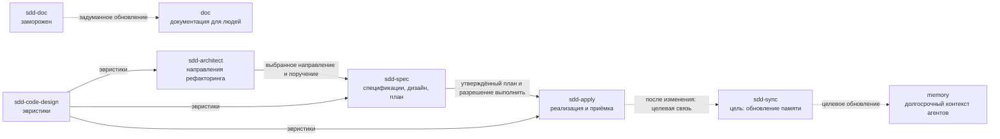

# Карта контекстов ai-sdlc

Карта помогает выбрать скилл по нужному результату и определить, где заканчивается
его ответственность. Она охватывает **10 собственных скиллов из `skills/`**
и показывает внешние скиллы, от которых зависит их работа.

Срез исходников и уточнения владельца: **2026-11-15**. `SKILL.md` и связанные
контракты описывают текущее поведение; решения владельца определяют назначение
и границы ответственности. Где они расходятся, ниже отдельно указаны текущее
и целевое состояния. Состав пакетов проверен по `packages/*/apm.yml`.
Названия понятий следуют [тезаурусу](THESAURUS.md).

## Настройки, документация и память

| Область | Назначение | Ответственность |
|---|---|---|
| Проектные настройки | Подготовить проект и задать параметры работы остальных `sdd-*` | **Только `sdd-setup` может изменять настройки. Все остальные скиллы читают их без записи** |
| `doc` — документация проекта | Объяснять проект людям | Задуманная область `sdd-doc`; скилл заморожен, пока не определён состав документации |
| `memory` — память проекта | Сохранять долгосрочный контекст для работы агентов | Обновление после изменения проекта — целевая ответственность `sdd-sync` |

`doc` и `memory` различаются адресатом и назначением. Оба могут содержать Markdown,
но наличие файла в поисковом индексе не делает человеческую документацию памятью
агента. Эта карта находится в `memory/`, чтобы агенты учитывали границы скиллов
в следующих задачах. Обозначение `doc` здесь называет область ответственности;
существующая документация репозитория размещена в `docs/`.

Правило записи настроек относится ко всем скиллам, включая `sdd-shared`, `sdd-kb`
и будущие версии `sdd-doc` и `sdd-sync`. Если для работы нужны другие настройки,
их изменение относится к `sdd-setup`. Создание отчёта, запись состояния работы
и обновление памяти сами по себе не являются изменением проектных настроек.

## Общая схема

Репозиторий соединяет подготовку и выполнение изменений программного продукта
с его архитектурным анализом, ведением знаний и разработкой самих скиллов.
Эти задачи образуют несколько связанных областей применения:

| Область | Основной вопрос | Скиллы и их вклад |
|---|---|---|
| Подготовка и выполнение SDD-изменения | Что изменить, как устроить решение, как выполнить и проверить работу? | `sdd-spec` готовит комплект и план; `sdd-apply` выполняет и собирает свидетельства результата |
| Аудит техдолга и проектирование | Что в устройстве программы мешает изменениям и какой подход стоит выбрать? | `sdd-architect` исследует Kotlin/JVM-проект и предлагает направления; `sdd-code-design` даёт эвристики проектирования и ревью |
| Документация для людей | Какие материалы нужны человеку, чтобы понимать проект и работать с ним? | `sdd-doc` задуман для обновления проектной документации; сейчас заморожен |
| Долгосрочная память для агентов | Какой контекст проекта должен оставаться актуальным после изменений? | Целевое назначение `sdd-sync` — обновлять память после изменения; текущий перенос спецификаций считается устаревающим |
| Эксперименты с базой знаний | Как искать Markdown-материалы и показывать их связи? | `sdd-kb` — экспериментальный скилл; сейчас нигде не используется и не включён в рабочие связи |
| Разработка скиллов | Как создать, проверить, улучшить и упаковать способ работы агента? | `sdd-skill-conductor` ведёт жизненный цикл скилла |
| Подготовка проекта и общие контракты | Как подготовить проект к агентной разработке с `sdd-*`? | `sdd-setup` владеет проектными настройками; `sdd-shared` предоставляет общие форматы, роли и инструменты |

Группы нужны для выбора работы. Один скилл может обслуживать несколько групп;
каталог или совпадение слов ещё не задают отдельный bounded context.

Сплошные стрелки показывают существующие связи, пунктирные — целевую работу
с памятью и документацией. Начать `sdd-spec` можно с пользовательской задачи
без предварительного аудита. Целевое обновление памяти относится к изменениям
проекта и не ограничено только реализацией через `sdd-apply`.
Схема не означает автоматический запуск следующего скилла.

`sdd-shared` обслуживает настройку, аудит и SDD-процессы общими контрактами.
`sdd-setup` готовит проект к их использованию и единолично меняет проектные
настройки; сейчас реализованы аудит требований с проверкой mise и настройка
ролей, моделей и effort.
`sdd-skill-conductor` применяется
при работе над самими скиллами, включая скиллы этой цепочки.

## Подготовка и выполнение изменения

### sdd-spec — подготовить и согласовать работу

- **Назначение:** исследовать задачу, уточнить требования и ограничения, подготовить
  спецификации, дизайн и проверяемый план; вести обсуждение, пояснения, согласованное
  ревью и продолжение после перерыва.
- **Вход и результат:** пользовательская задача или существующий комплект документов
  превращаются в согласованный комплект с планом. Обычное изменение хранится в
  `sdd/changes/<change-id>/`, рефакторинг — в `sdd/refactoring/<change-id>/`.
- **Когда использовать:** при явном вызове скилла для подготовки или пересмотра
  SDD-работы. После начала последующие сообщения продолжают выбранный процесс.
- **Не использовать:** для автоматического перевода любой просьбы «спланируй» в SDD;
  для выполнения кода, переноса baseline или архивирования. Утверждение комплекта
  само по себе не является разрешением реализовать план.
- **Связи:** использует `sdd-shared`; автор применяет FPF, а при программном дизайне
  автор и ревью — `sdd-code-design`. Передаёт утверждённый план в `sdd-apply`
  при действующем разрешении выполнить его.

Источники: [SKILL.md](../skills/sdd-spec/SKILL.md),
[авторский флоу](../skills/sdd-spec/references/architect.md),
[разделение обычного изменения и рефакторинга](../skills/sdd-spec/references/refactoring.md).

### sdd-apply — выполнить утверждённый план

- **Назначение:** довести задачи плана до принятой реализации: организовать
  исполнителей, изолированные рабочие деревья, проверки, независимое ревью,
  исправления и интеграцию результатов.
- **Вход и результат:** утверждённый план `sdd-spec` и явное разрешение выполнить его;
  результат — принятые задачи, коммиты, свидетельства проверок и отчёт о выполнении.
  Состояние выполнения хранится в `execution/` выбранной работы.
- **Когда использовать:** начать, продолжить или принять выполнение такого плана.
  Запрос состояния позволяет осмотреть прогресс, но не начать новую реализацию.
- **Не использовать:** для придумывания или пересмотра нормативного плана в ходе
  исполнения, произвольной задачи без согласованного плана, OpenSpec-процесса,
  публикации, самостоятельного изменения проектных настроек или автоматического
  запуска обновления памяти.
- **Связи:** читает нормативные документы через `sdd-shared`; исполнители и ревью кода
  применяют `sdd-code-design`. Нормативный конфликт возвращает к пересмотру основания
  работы; завершённое выполнение даёт сведения об изменении для целевого
  обновления памяти через `sdd-sync`.

Источники: [SKILL.md](../skills/sdd-apply/SKILL.md),
[политика ревью](../skills/sdd-apply/references/review-policy.md).

## Аудит техдолга и проектирование

### sdd-architect — найти обоснованные направления рефакторинга

- **Назначение:** исследовать архитектуру **Kotlin/JVM-проекта на Gradle** по
  исходникам и измерениям, объяснить причины проблем, сравнить направления улучшения
  и упорядочить рекомендации по эффекту.
- **Вход и результат:** проект, область аудита и его политика; результат — отчёт
  аудита, карточки рекомендаций, очередь дальнейшего исследования и обновлённый
  план техдолга. Полный успешный аудит также публикует показатели проекта и модулей.
  Материалы хранятся в `memory/tech-debt/` целевого проекта.
- **Когда использовать:** по явному вызову для полного аудита; по отдельному
  указанию — для анализа представленных отчётов, сравнения предложений, ревью diff
  или переоценки выполненного изменения. Вызов без уточнений начинает полный цикл.
- **Не использовать:** как универсальный аудитор любого стека, для реализации
  рефакторинга, подробного проектирования контрактов пакетов, создания или разделения
  Gradle-проектов. Метрики дают основания для исследования, а не готовый диагноз.
  Неполные обязательные измерения не разрешают выдать сокращённый аудит за полный.
- **Связи:** применяет `sdd-code-design` для диагностики; использует общие роли
  архитектора и исследователя из `sdd-shared`. Готовая рекомендация передаётся
  человеку для обсуждения в `sdd-spec`; план техдолга не заменяет план реализации.

Источники: [SKILL.md](../skills/sdd-architect/SKILL.md),
[диагностика](../skills/sdd-architect/references/diagnosis.md),
[ведение плана техдолга](../skills/sdd-architect/references/tech-debt-plan.md).

### sdd-code-design — применить эвристики программного дизайна

- **Назначение:** помогать выбирать и оценивать устройство программы: декомпозицию,
  инкапсуляцию, API, работу с эффектами, тестами, сложностью и изменениями.
  Основа — книга Марка Симана *Code That Fits in Your Head* и отдельно отмеченные
  дополнения для разработки с агентами.
- **Вход и результат:** конкретная задача проектирования, реализации, ревью,
  диагностики, отладки или анализа угроз; результат — применённые к этой задаче
  эвристики и выбранный рабочий подход. Примеры на C#, Kotlin и Go не ограничивают стек.
- **Когда использовать:** только по явному вызову пользователя или прямому указанию
  уже активного скилла. Поддерживает самостоятельную работу и использование внутри
  `sdd-spec`, `sdd-architect`, `sdd-apply` в назначенной ими области.
- **Не использовать:** как автоматически включаемую политику для любого кода,
  универсальный набор безусловных законов, самостоятельный измеритель качества
  или разрешение изменить согласованный объём работы и проектные настройки.
  Эвристики не заменяют проектные правила и критерии приёмки; запись настроек
  принадлежит `sdd-setup`.
- **Связи:** поставляет методы проектирования и оценки; вызывающий процесс сохраняет
  ответственность за план, разрешения, состояние работы и приёмку.

Источники: [SKILL.md](../skills/sdd-code-design/SKILL.md),
[выбор рекомендаций по задаче](../skills/sdd-code-design/guidelines.md).

## Документация для людей и память для агентов

### sdd-sync — обновить память проекта после изменения

- **Целевое назначение:** актуализировать долгосрочную память проекта для агентов
  после изменения проекта. Это назначение определено владельцем и выходит за
  пределы переноса спецификаций.
- **Текущее состояние:** реализован перенос дельты требований в `sdd/specs/`
  и архивирование завершённого изменения. Владелец обозначил эту роль как
  устаревающую (deprecated); контракт обновления `memory` ещё не реализован.
- **Вход и результат:** в целевом виде — сведения об изменении проекта и актуализированная
  память. В текущем — завершённое SDD-изменение, обновлённые спецификации, `sync.md`
  и архив в `sdd/changes/archive/`; есть превью и перенос без архива.
- **Когда использовать:** целевое место — обновление памяти после изменения.
  Текущую реализацию можно оценивать только как перенос спецификаций и архивирование;
  её успешное завершение не доказывает актуальность всей памяти проекта.
- **Не использовать:** для обновления документации для людей, записи проектных
  настроек, синхронизации Git-веток или установленных скиллов, реализации изменений.
  Устаревающий перенос спецификаций не задаёт границы будущего `memory`.
- **Связи:** получает сведения о выполненных изменениях, в том числе от `sdd-apply`;
  настройки читает без записи. Текущая реализация использует `sdd-shared` и
  свидетельства исполнения. Экспериментальный `sdd-kb` не является его действующей
  зависимостью или назначенным механизмом обновления памяти.

Основание назначения: решение владельца от 2026-11-15.
Источники текущего поведения: [SKILL.md](../skills/sdd-sync/SKILL.md),
[проверка завершения и перенос](../skills/sdd-sync/references/workflow.md).

### sdd-kb — эксперимент с Markdown-базой знаний; не используется

- **Статус:** экспериментальный скилл, который сейчас никак не используется.
  Его наличие в `skills/` не означает включение в рабочий процесс проекта.
- **Назначение эксперимента по исходникам:** работа с Markdown-базой знаний через
  GitMark: поиск и ответы по документам, структурные запросы, проверка метаданных
  и ссылок, создание и обновление документов, построение карты связей.
- **Вход и результат:** документы и, при их подготовке, исходники и конфигурация;
  результат — ответ с основаниями, поддерживаемые Markdown-документы либо HTML-карта
  их связей. `.gitmark/index.db` и `.gitmark/docs-map.html` — производные артефакты.
- **Когда использовать:** для отдельного исследования этого эксперимента по
  явному поручению. Описанные в исходнике маршруты Search, Inspect, Curate, Build
  и Map не являются принятым способом работы с `doc` или `memory` в проекте.
- **Не использовать:** для реализации функций, релиза, общего веб-исследования
  или произвольного текста вне базы знаний. Граф документов не доказывает архитектуру
  кода, а успешный lint не подтверждает выполнение требований SDD.
- **Связи:** действующих связей с остальными скиллами не назначено. Его нельзя
  автоматически подставлять вместо замороженного `sdd-doc` или будущего механизма
  обновления памяти в `sdd-sync`. При отдельном использовании эксперимента действует
  общее правило: проектные настройки доступны только для чтения.

Основание статуса: решение владельца от 2026-11-15.
Источники возможностей эксперимента: [SKILL.md](../skills/sdd-kb/SKILL.md),
[ведение документов](../skills/sdd-kb/references/curate.md),
[построение базы](../skills/sdd-kb/references/build.md),
[карта документов](../skills/sdd-kb/references/map.md).

### sdd-doc — обновлять документацию для людей; заморожен

- **Задуманное назначение:** обновлять проектную документацию для людей (`doc`).
  Область не ограничивается глоссарием.
- **Текущее состояние:** скилл **заморожен**, поскольку состав проектной документации
  пока не определён. Существующий `SKILL.md` описывает более узкую работу с глоссарием;
  это текущий материал реализации, а не окончательное назначение скилла.
- **Вход и результат:** в замысле — сведения о проекте и обновлённая человеческая
  документация. Точный набор документов ещё предстоит определить. В текущих
  инструкциях результатом служит глоссарий, по умолчанию `docs/glossary.md`.
- **Когда использовать:** до определения состава документации и возобновления работы
  скилл остаётся вне рекомендуемого процесса обновления `doc`.
- **Не использовать:** для обновления долгосрочной памяти агентов, изменения
  проектных настроек, реализации функций или автоматического переименования
  контрактов. Нельзя выводить состав всей документации из текущего флоу глоссария.
- **Связи:** целевая граница с `sdd-sync` проходит по адресату результата:
  люди (`doc`) и агенты (`memory`). Сходство текущего глоссария с задачами
  `ubiquitous-language` не означает, что тот заменил задуманную роль `sdd-doc`.

Основание назначения и статуса: решение владельца от 2026-11-15.
Источники текущего поведения: [SKILL.md](../skills/sdd-doc/SKILL.md),
[работа с глоссарием](../skills/sdd-doc/references/glossary.md),
[политика вызова в Codex](../skills/sdd-doc/agents/openai.yaml).

## Разработка скиллов

### sdd-skill-conductor — создавать и сопровождать скиллы

- **Назначение:** определить задачи и границы скилла, выбрать структуру инструкций,
  создать или улучшить пакет, проверить качество, исследовать срабатывание,
  сравнить варианты и подготовить распространение.
- **Вход и результат:** сценарии использования либо существующий скилл;
  результат — исходники инструкций и ресурсов, результаты согласованных проверок
  и, при поручении упаковать, файл `.skill`. Режимы: CREATE, IMPROVE, VALIDATE,
  REVIEW, OPTIMIZE, PACKAGE.
- **Когда использовать:** при создании, изменении, проверке и упаковке скиллов;
  это прямо закреплено в `AGENTS.md` данного репозитория.
- **Не использовать:** для обычного применения готового скилла или разработки
  программной функции лишь потому, что работу выполняет агент. Нельзя автоматически
  запускать поведенческие эвалуации по общему поручению изменить скилл: здесь для
  этого требуется отдельное явное согласие пользователя.
- **Связи:** может применяться внутри разрешённой реализации плана `sdd-apply`,
  если предмет задачи — скилл. Тогда `sdd-apply` управляет выполнением плана,
  а conductor задаёт правила разработки скилла. Изменяются исходники в `skills/`;
  обновление установленных копий требует отдельного поручения.

Источники: [SKILL.md](../skills/sdd-skill-conductor/SKILL.md),
[правила репозитория](../AGENTS.md).

## Общие контракты и настройка

### sdd-shared — предоставить общий контракт SDD

- **Назначение:** хранить общие форматы документов, парсеры и валидаторы,
  механизмы Git-checkpoint, контракт настроек и выбора субагентов, инструкции ролей
  и правила координации.
- **Вход и результат:** запрос вызывающего процесса на чтение, проверку, выбор роли
  или общий механизм; результат — данные, свидетельство проверки либо разрешённый
  вызовом технический результат. Загружается только нужная часть общего API.
- **Когда использовать:** как зависимость `sdd-setup`, `sdd-spec`, `sdd-architect`,
  `sdd-apply`, `sdd-sync`, либо для явного изучения общего API.
- **Не использовать:** как самостоятельный процесс планирования, настройки,
  исполнения или приёмки. Структурно корректный документ ещё не означает
  согласованный план, выполненную задачу или разрешённый переход. Общий механизм
  работы с настройками не даёт вызывающим скиллам права их записывать.
- **Связи:** владеет общими механизмами. Документы и фазы подготовки принадлежат
  `sdd-spec`, запись настроек — `sdd-setup`, состояние и операции исполнения —
  `sdd-apply`. Текущий `sdd-sync` использует общий формат спецификаций; его целевое
  назначение — обновление памяти. Вызывающий процесс принимает решения на основании
  общей проверки; запись проектных настроек остаётся исключительно за `sdd-setup`.

Источники: [SKILL.md](../skills/sdd-shared/SKILL.md),
[разделение ролей и процессов](../skills/sdd-shared/references/coordination.md),
[выбор субагентов](../skills/sdd-shared/references/subagents.md).

### sdd-setup — подготовить проект к агентной разработке

- **Назначение:** подготовить проект к агентной разработке с использованием остальных
  `sdd-*`. Это **единственный владелец изменения проектных настроек** для этих скиллов,
  включая политики архитектурного анализа.
- **Текущее состояние:** вызов без параметров последовательно проводит аудит требований
  с исправлением несоответствий, затем диалог выбора агентов для ролей, моделей и effort
  в Codex и Claude Code. Первое обязательное требование — установленная и работающая
  mise в среде выполнения проекта. Отдельно доступны аудит без изменений, исправление
  требований и настройка только ролей. Настройка политик остальных скиллов относится к его области,
  даже если соответствующие операции пока отсутствуют в интерфейсе.
- **Вход и результат:** проект, требования к использованию SDD-скиллов и решения
  пользователя; результат — проверенные требования и подготовленная проектная
  конфигурация. Команда `audit` фиксирует наличие и работоспособность mise;
  после установки или исправления проверка повторяется. Настройка ролей записывает
  `.sdd/settings.json` и определения агентов через `inspect → plan → apply → inspect`.
- **Когда использовать:** для первоначальной подготовки проекта и изменения
  настроек остальных `sdd-*`. Текущий процесс запускается явно; согласованное
  изменение не требует повторного разрешения на ту же запись.
- **Не использовать:** для реализации продуктовых изменений, ведения человеческой
  документации или обновления памяти вместо профильного скилла. Текущая реализация
  не покрывает ключи, провайдеров, MCP, права и глобальную конфигурацию среды
  за пределами установки/восстановления mise. Перенос зависимостей в mise пока не реализован;
  широкое назначение не означает, что эти возможности уже реализованы.
- **Связи:** использует общие контракты `sdd-shared`. Все остальные скиллы получают
  проектные настройки только для чтения. Отсутствие нужной операции в `sdd-setup`
  не передаёт право записи другому скиллу.

Основание назначения и исключительного права записи: решение владельца от 2026-11-15.
Источники текущего поведения: [SKILL.md](../skills/sdd-setup/SKILL.md),
[интерфейс настройки](../skills/sdd-setup/references/api.md),
[требования к проекту](../skills/sdd-setup/references/project-audit.md).

## Границы, на которых легко выбрать не тот скилл

| Похожие названия или результаты | Как различать |
|---|---|
| `sdd-architect` и роль `sdd-spec.architect` | Скилл проводит аудит; роль выполняет архитектурное исследование и авторскую работу внутри вызвавшего её процесса. Назначение роли не запускает аудит |
| План техдолга и план реализации | Первый хранит направления и приоритеты; второй задаёт задачи, зависимости и проверки для `sdd-apply`. Статус рекомендации `ready` означает готовность обсуждать направление |
| `doc` и `memory` | Документация служит людям, долгосрочная память — агентам. `sdd-doc` задуман для обновления `doc`; `sdd-sync` — для актуализации `memory` после изменения проекта |
| `sdd-doc` и `sdd-kb doc` | Первый задуман для человеческой документации и заморожен; второй — команда экспериментального, пока не используемого скилла. Команда не задаёт владельца области `doc` |
| Настройки и результаты работы | Только `sdd-setup` изменяет проектные настройки скиллов. Отчёты, состояние исполнения и память имеют собственное назначение и не становятся настройками из-за формата или расположения файла |
| Эта карта и `sdd-kb map` | Здесь описаны назначения и границы скиллов; там строится граф существующих документов и ссылок |
| Проверка структуры и приёмка | `sdd-shared` проверяет формат; содержательное заключение и решение о переходе остаются за соответствующими ролями и процессом |
| Baseline спецификаций и baseline эвалуации | В текущем устаревающем процессе `sdd-sync` это действующие требования; при оценке скилла — исходный вариант для сравнения. Ни один смысл не определяет всю долгосрочную память |
| Архитектурный модуль и Gradle-проект | Для аудита модуль задаётся ответственностью, группой пакетов, контрактом и правилами зависимостей; Gradle-проект задаёт область сбора |

## Внешние скиллы и состав пакетов

Следующие скиллы подключаются из других репозиториев. Их назначение здесь показано
в пределах связей с ai-sdlc; установленные копии не являются собственными исходниками.

| Скилл | Место в схеме | Для чего не служит |
|---|---|---|
| `fpf-problem-solving` | Методы рассуждения; обязателен для автора в `sdd-spec`; применён при составлении этой карты | Не заменяет предметные источники, SDD-процесс, разрешение на реализацию или проверку результата |
| `ubiquitous-language` | Тезаурус и выбор согласованных доменных имён; в этом репозитории подключён правилами `AGENTS.md` | Не определяет поведение продукта вместо спецификации и не разрешает переименовать существующие контракты одним обновлением словаря |
| `humanizer-ru` | Редактура русской прозы; в `sdd-spec` проход предлагается пользователю. Исходники замороженного `sdd-doc` тоже содержат этот этап | Не меняет факты, нормативную силу требований и канонические термины ради гладкости текста |
| `archify` | Пояснение устройства и связей через диаграммы; вызывается в `sdd-spec` при подготовке визуального объяснения | Не подменяет выбор архитектурного решения и не подтверждает его реализацию |

Источники связей: [авторский флоу](../skills/sdd-spec/references/architect.md),
[пояснение решения](../skills/sdd-spec/flows/explain.md),
[редактура в sdd-spec](../skills/sdd-spec/references/editorial-pass.md),
[редактура в sdd-doc](../skills/sdd-doc/references/editorial-pass.md),
[AGENTS.md](../AGENTS.md).

Фактический состав пакетов на дату карты:

- [aisdlc-core](../packages/aisdlc-core/apm.yml): `sdd-shared`, `sdd-setup`,
  `sdd-architect`, `sdd-spec`, `sdd-apply`, `sdd-sync`, `sdd-code-design`,
  `ubiquitous-language`, `fpf-problem-solving` и `common-dependencies`.
- [aisdlc-skills](../packages/aisdlc-skills/apm.yml): `sdd-skill-conductor`
  и `common-dependencies`.
- [common-dependencies](../packages/common-dependencies/apm.yml): `humanizer-ru`
  и `archify`.
- [aisdlc-experimental](../packages/aisdlc-experimental/apm.yml): зависимостей нет.
- `sdd-doc` и `sdd-kb` существуют в `skills/`, но в эти пакеты сейчас не включены.

Пакет определяет распространение; его состав не задаёт границы ответственности
скиллов. Каталоги `.agents/skills/`, `.claude/skills/` и `apm_modules/` содержат
установленные зависимости. Исторические комплекты в `sdd/` и `openspec/`, фикстуры
и результаты проверок не добавляют самостоятельные скиллы к этой карте.

## Подтверждённые границы и незавершённые части

Владелец уточнил 2026-11-15:

1. `sdd-doc` задуман для обновления документации проекта для людей. Сейчас он
   заморожен, поскольку состав документации ещё не определён.
2. `sdd-setup` подготавливает проект к агентной разработке с остальными `sdd-*`
   и единственный может менять проектные настройки. Все остальные скиллы читают
   настройки без записи. Поэтому настройка политики архитектурного анализа
   относится к его ответственности, хотя текущий интерфейс её ещё не реализует.
3. Перенос спецификаций — устаревающее назначение `sdd-sync` (deprecated).
   Его целевая задача — обновлять долгосрочную память проекта для агентов после
   изменения. Документация для людей (`doc`) и память для агентов (`memory`) разделены.
4. `sdd-kb` экспериментальный и пока никак не используется. Действующих связей
   с другими скиллами у него не назначено.

Состав `doc`, контракт обновления `memory` и недостающие операции подготовки
проекта требуют дальнейшей разработки. Определённая ответственность не означает,
что эти возможности уже реализованы. Карта фиксирует решения о назначении;
изменения поведения реализуются отдельно в исходниках скиллов.

В [README](../README.md) таблица пакетов расходится с манифестами: упоминает
`sdd-implement`, которого нет среди текущих исходников, и иначе распределяет
`sdd-doc`, `sdd-kb`, FPF и `ubiquitous-language`. Поэтому состав выше взят из
манифестов, текущее поведение — из инструкций, назначение и статусы — с учётом
уточнений владельца. Исправление README и изменение пакетов не входят
в составление карты.

## Основание и обновление карты

Из FPF применены три приёма: **F.0.1:4.1** — восстановить смысл названия из
конкретного источника; **F.0.2.MA:4.1** — сопоставить вклад скиллов по действию,
результату и условиям, сохранив различия; **C.39.WA:4.2–4.3** — объяснить связи
между частями и условия передачи результата. Проверка применимости **A.1.1:0–1**
не даёт оснований объявлять каждый каталог самостоятельным bounded context.
После уточнений владельца применён **B.5.RR:4.1–4.5**: пересмотрены карточки,
общая схема и связанные выводы, которые опирались на прежнее прочтение назначения.

При изменении назначения скилла обновляй его карточку, связанные переходы
и отрицательные границы. При добавлении или удалении `skills/*/SKILL.md`
пересматривай охват; при изменении `packages/*/apm.yml` — раздел распространения.
Решение пользователя по открытой границе должно заменить вопрос и уточнить
затронутые карточки; изменение самой карты не меняет поведение скиллов.
