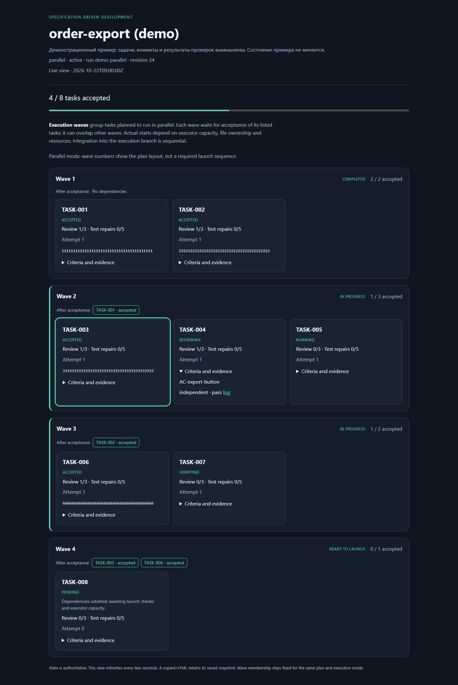
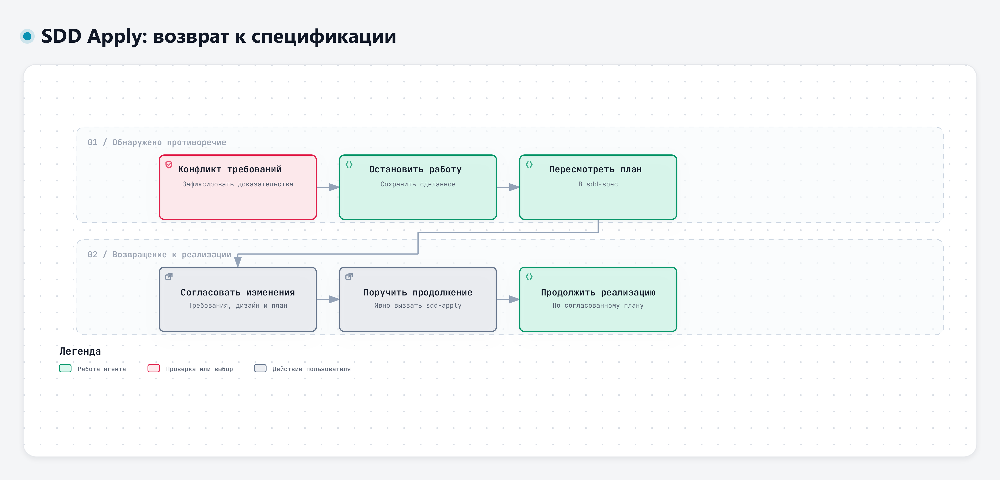

# SDD Apply

`sdd-apply` выполняет согласованный план разработки из `sdd-spec`. На выходе вы получаете изменения в коде с локальными коммитами, результаты независимых проверок и отчёт о выполненных критериях приёмки.

В [AI SDLC](https://github.com/AndrMoiseev/ai-sdlc/blob/main/README.md) этот скилл отвечает за реализацию. Требования, дизайн и план задач готовит [`sdd-spec`](https://github.com/AndrMoiseev/ai-sdlc/blob/main/skills/sdd-spec/README.md); роли агентов на уровне проекта настраивает [`sdd-setup`](https://github.com/AndrMoiseev/ai-sdlc/blob/main/skills/sdd-setup/SKILL.md). `sdd-apply` работает по согласованным документам. Если при разработке выясняется, что их нужно пересмотреть, агент передаёт проблему обратно в `sdd-spec`.

## Начать работу

Вызовите скилл явно и укажите изменение с согласованным планом. В примерах используется Codex; для Claude Code замените `$sdd-apply` на `/sdd-apply`.

```text
$sdd-apply Реализуй согласованный план изменения order-export.
```

Агент проверит готовность документов и состояние репозитория. Если согласований не хватает или остались блокирующие вопросы, он укажет, что нужно решить в `sdd-spec`. При готовом плане продолжит работу до завершения или конкретного препятствия.

Запуск разрешает создавать локальные коммиты по задачам. Отправка в удалённый репозиторий, слияние веток, выпуск версии и развёртывание требуют отдельного поручения.

## Как выполняется план

По умолчанию агент выбирает параллельный режим, если задачи можно изолировать. Независимые задачи выполняются в отдельных рабочих копиях Git с учётом зависимостей, общих файлов и ресурсов. В общую ветку результаты попадают по очереди; после переноса они снова проходят проверку и ревью кода.

Можно попросить последовательный режим. Тогда следующая задача начинается только после приёмки предыдущей. Если текущая задача заблокирована, весь план ждёт её решения. В обоих режимах нужны отдельные рабочие копии Git. Если создать их невозможно, агент сообщит причину остановки.

Для каждой задачи агент проверяет исходное состояние и пишет код в отдельной рабочей копии. Перед проверками он сохраняет результат локальным коммитом в ветке задачи. Самопроверка, независимые тесты и ревью относятся к этому коммиту; после исправлений агент создаёт следующий коммит и повторяет проверки. До переноса результата основная ветка не меняется.

После переноса в общую ветку агент фиксирует и проверяет результат интеграции. Задача считается принятой после успешных проверок и ревью этого результата. В конце весь план проходит проверку на итоговом коммите. Отправка коммитов на сервер для этих шагов не нужна.

Ссылку на панель прогресса вы получите в начале работы, при остановке и в итоговом отчёте. На ней видны задачи и их зависимости, результаты проверок, причины ожидания, коммиты и оставшиеся попытки исправления. Итоговый отчёт связывает задачи с коммитами и показывает, какие критерии приёмки подтверждены, а какие остались непроверенными.

## Тесты при рефакторинге

При слиянии или разделении модулей агент меняет тесты в пределах согласованного
плана. Он выбирает конкретные файлы и случаи проверки без отдельного разрешения
на каждый тест. Для новой границы он проверяет её контракт и взаимодействие
модулей с учётом риска ошибок.

Например, старый тест проверял внутренний вызов и атомарность операции:
при ошибке все данные должны остаться прежними.
После слияния модулей проверку вызова можно удалить по принятому решению.
Проверку атомарности нужно сохранить на подходящем уровне. Независимый рецензент
сверит эти изменения с планом, исходными результатами и новыми тестами.
Если требуется изменить само обязательство или архитектуру, агент вернёт
вопрос в `sdd-spec`.

## Пример дашборда в параллельном режиме

Ниже показан демонстрационный запуск `order-export`. Задачи, коммиты и результаты проверок в нём вымышлены; состояние примера не меняется.

[](assets/examples/parallel-dashboard/dashboard.html)

На снимке приняты четыре из восьми задач. `TASK-004` проходит ревью, `TASK-005` разрабатывается, а `TASK-007` проверяется независимым агентом. `TASK-008` уже готова к запуску: обе её зависимости, `TASK-003` и `TASK-006`, приняты. Ждать завершения остальных задач ей не требуется; старт зависит от свободного исполнителя и доступных ресурсов.

Блоки `Wave` объединяют задачи с одинаковыми зависимостями, которые можно выполнять параллельно. Несколько таких групп могут работать одновременно. [Откройте пример дашборда](assets/examples/parallel-dashboard/dashboard.html), чтобы перейти по ссылкам зависимостей и раскрыть `Criteria and evidence` с критериями приёмки и примерами результатов проверок.

## Примеры запросов

`order-export` здесь обозначает ваше изменение. Номера задач и замечаний в примерах замените на номера из отчёта агента.

| Сценарий | Пример запроса | Ожидаемый результат |
| --- | --- | --- |
| Запустить реализацию | `$sdd-apply Реализуй согласованный план order-export.` | Агент проверит готовность и начнёт работу. При доступной изоляции выберет параллельный режим. |
| Изменить границы модулей | `$sdd-apply Выполни согласованный план слияния модулей ledger. Сохрани атомарность операций.` | Агент изменит тесты в пределах плана; независимое ревью проверит, что после удаления старой границы сохранились проверки поведения. |
| Выполнять задачи по одной | `$sdd-apply Реализуй order-export последовательно.` | Каждая следующая задача будет ждать приёмки предыдущей. |
| Продолжить после перерыва | `$sdd-apply Продолжи order-export с сохранённого состояния.` | Агент сверит сохранённый прогресс с файлами и коммитами, сохранит режим и продолжит незавершённую работу. |
| Перейти к последовательной работе | `$sdd-apply Продолжи order-export в последовательном режиме. Сохрани уже сделанное.` | Агент передаст координацию новому агенту. Если остались результаты в отдельных рабочих копиях, сначала потребуется решить, как с ними поступить. |
| Перейти к параллельной работе | `$sdd-apply Продолжи order-export параллельно, если изоляция доступна.` | После проверки изоляции новый агент продолжит координацию в параллельном режиме. При невозможности перехода агент сообщит причину. |
| Продолжить после исправления ошибки | `$sdd-apply В order-export обязательные тесты ранее не запускались. Причина устранена. Проверь это и продолжи.` | Агент проверит, что препятствие устранено, и возобновит прерванную задачу с прежними счётчиками попыток. |
| Выполнить пересмотренный план | `$sdd-apply В sdd-spec согласован обновлённый план order-export. Продолжи реализацию по нему.` | Завершённые задачи сохранят историю и коммиты. Незавершённые будут заново оценены по новым требованиям; доработки принятого результата пойдут отдельными новыми задачами. |
| Завершить приёмку | `$sdd-apply Все задачи order-export приняты. Выполни итоговую проверку и заверши работу.` | Независимые агенты проверят итоговый коммит. При успехе появится итоговый отчёт, при ошибке агент вернётся к соответствующей задаче. |
| Увеличить лимит исправлений | `$sdd-apply Для TASK-003 в order-export увеличь общий лимит циклов исправления после тестов с 5 до 7 и продолжи.` | Агент запишет конечный лимит для указанной задачи и продолжит исправление. Лимит ревью останется прежним. |
| Увеличить лимит ревью | `$sdd-apply Для TASK-003 в order-export увеличь общий лимит ревью с 3 до 4 и продолжи.` | Агент получит ещё один раунд ревью. Лимит исправлений после тестов останется прежним. |
| Вернуть проблему в спецификацию | `$sdd-apply По блокировке TASK-003 в order-export подготовь передачу в sdd-spec для пересмотра требований.` | Агент сохранит выполненную работу и передаст описание проблемы, доказательства и список завершённых задач. Документы пересматриваются в `sdd-spec`. |
| Остановиться с частичным результатом | `$sdd-apply Останови работу над order-export. Сохрани текущие изменения и покажи выполненные задачи и оставшиеся проблемы.` | Агент остановит исполнителей, сохранит состояние и подготовит отчёт для последующего продолжения. |
| Исправить выбранный технический долг | `$sdd-apply План order-export завершён. Согласовываю отдельное исправление замечания R-001 из журнала технического долга.` | Агент выполнит только согласованное исправление с нужными проверками. Если оно меняет требования или дизайн, потребуется вернуться в `sdd-spec`. |
| Оставить рекомендации на потом | `$sdd-apply План order-export завершён. Замечания из журнала технического долга пока оставляем без исправлений.` | Завершённый результат сохранится, рекомендации останутся в журнале. |

## Когда потребуется ваше решение

Доказанное нарушение критерия приёмки, принятого архитектурного решения или правила проекта требует исправления. Остальные замечания ревью агент сохраняет в журнал технического долга и продолжает план. После завершения он покажет рекомендации и предложит выбрать конкретные доработки. Сами по себе рекомендации не мешают завершить реализацию.

На каждую задачу отведено пять циклов исправления после неудачных проверок и три раунда ревью, включая первый. Эти лимиты действуют на протяжении всей задачи, в том числе после переноса кода в общую ветку и при итоговой проверке. Перезапуск сессии и замена агента их не обнуляют. Успешная последняя попытка позволяет продолжить; если нужна ещё одна, весь запуск останавливается. Тогда вы можете задать новый конечный лимит, вернуть проблему в `sdd-spec` или сохранить частичный результат.

При противоречии в требованиях агент прекращает работу по старой версии документов. После их пересмотра и согласования вы снова поручаете реализацию. Если обязательную проверку невозможно запустить, отчёт остаётся частичным до устранения причины.

[](assets/diagrams/plan-revision.html)

При пересмотре плана история завершённых задач сохраняется. [Открыть интерактивную схему возврата к спецификации](assets/diagrams/plan-revision.html).
